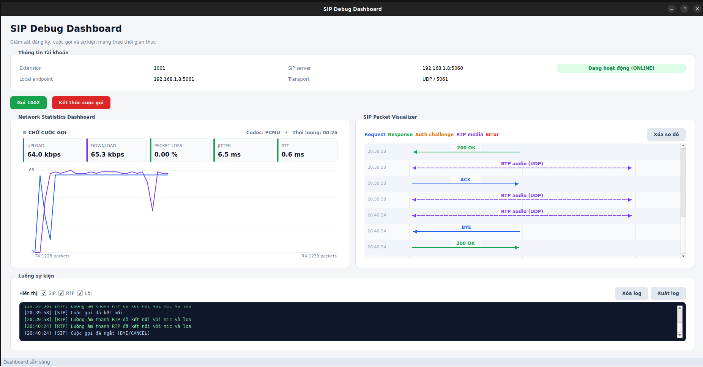

# VoIP SIP Simulator

A Qt Widgets desktop client for learning and debugging SIP call flows with Asterisk and PJSUA2. The application registers extension `1001`, calls a second endpoint such as Linphone extension `1002`, visualizes SIP messages, and displays live RTP/RTCP network statistics.



## Features

- SIP registration with Digest authentication.
- Outgoing, incoming, and hangup call handling.
- Microphone and speaker connection for RTP audio.
- SIP sequence diagram for REGISTER, INVITE, responses, ACK, RTP, and BYE.
- Live upload/download bitrate, packet count, loss, jitter, RTT, codec, and call duration.
- Filterable SIP, RTP, and error logs with text export.
- Thread-safe delivery of PJSIP callback updates to the Qt UI.

## Project Structure

```text
.
├── main.cpp                         Application entry point
├── mainwindow.{h,cpp,ui}            SIP callbacks and main dashboard
├── sipsequencewidget.{h,cpp}        SIP sequence diagram
├── networkstatswidget.{h,cpp}       RTP/RTCP statistics dashboard
├── assets/                          Screenshots and media
├── docs/PROGRESS.md                 Completed work and known limitations
└── docs/ROADMAP.md                  Planned improvements
```

## Requirements

- Linux with a C++17 compiler
- CMake 3.16 or newer
- Ninja
- Qt 5 or Qt 6 with `Widgets` and `Network`
- PJSIP/PJSUA2 headers in `/usr/local/include`
- PJSIP libraries in `/usr/local/lib`
- OpenSSL, ALSA, and pthread development libraries
- An accessible Asterisk server and a second SIP client

The current CMake configuration expects a locally compiled PJSIP installation under `/usr/local`.

## Build and Run

Configure an out-of-tree debug build:

```bash
cmake -S . -B build -G Ninja -DCMAKE_BUILD_TYPE=Debug
cmake --build build
./build/SIP
```

If CMake cannot locate Qt, provide its installation prefix:

```bash
cmake -S . -B build -G Ninja \
  -DCMAKE_BUILD_TYPE=Debug \
  -DCMAKE_PREFIX_PATH=/path/to/Qt/6.x/gcc_64
```

Qt Creator users can open the root `CMakeLists.txt`. Select a new build directory inside the current repository; do not reuse the obsolete `/home/quang/Projects/SIP/build-SIP-Desktop-Debug` cache.

## SIP Configuration

The demo values currently live in `MainWindow::initPjsip()` and the outgoing call handler in `mainwindow.cpp`:

| Setting | Default |
| --- | --- |
| Local extension | `1001` |
| Password | `123456` |
| Realm | `asterisk` |
| Asterisk address | `192.168.1.8:5060` |
| Local SIP transport | UDP `5061` |
| Remote extension | `1002` |

Replace the server address with the IP of your Asterisk host. To list local addresses on Linux, run:

```bash
hostname -I
```

These values are intended for a private lab. Never commit production credentials or public server addresses.

## Configure the Second Endpoint

Install Linphone or another SIP client on a different device and create a third-party SIP account:

```text
Username: 1002
Password: 123456
Domain / SIP server: <asterisk-ip>:5060
Transport: UDP
```

Confirm that both endpoints are registered from the Asterisk CLI:

```bash
sudo asterisk -rvvv
pjsip show endpoints
pjsip show contacts
```

## Test a Call

1. Start Asterisk and register endpoint `1002` in Linphone.
2. Launch the Qt application and wait for the status to become **ONLINE**.
3. Select **Call 1002** and accept the call in Linphone.
4. Check the SIP visualizer for INVITE, provisional responses, `200 OK`, ACK, and RTP.
5. Compare loss, jitter, RTT, and bitrate with a Wireshark capture.
6. End the call from either endpoint and confirm the BYE exchange.

## Troubleshooting

- `401 Unauthorized` followed by an authenticated retry and `200 OK` is a normal Digest authentication flow.
- JACK startup messages are usually harmless when ALSA opens successfully.
- `QObject ... different thread` indicates that a PJSIP callback is modifying a Qt widget directly. Route updates through a queued GUI-thread method.
- `481 Call/Transaction Does Not Exist` indicates a SIP dialog mismatch; inspect Call-ID, tags, CSeq, and the Asterisk dial plan.
- If the application launches old code, clear the Qt Creator CMake configuration and select a build directory under this repository.

## Project Tracking

- [Completed work and current status](docs/PROGRESS.md)
- [Planned improvements](docs/ROADMAP.md)
- [Contributor guidelines](AGENTS.md)
